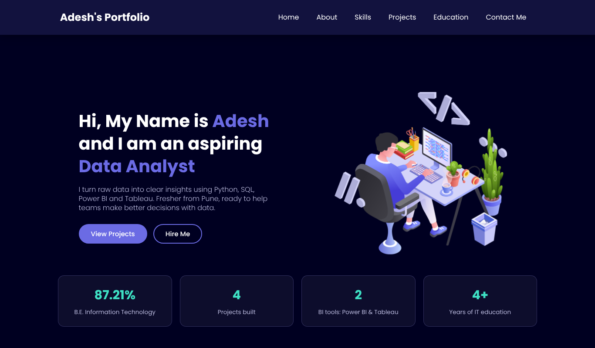

# Adesh Padwal | Data Analyst Portfolio

My personal portfolio website, built to show my skills, projects and background as an aspiring **Data Analyst**.

🔗 **Live site:** https://adesh2004.github.io



## What's inside
- **Home:** intro with animated typing text
- **About:** who I am and what I'm looking for
- **Skills:** Python, pandas, SQL / MySQL, Power BI, Tableau and more
- **Projects:** Retail Sales Dashboard, Cryptocurrency Price Prediction, Student Management System, E-Commerce Mobile App
- **Education & Training**
- **Contact:** email, LinkedIn, GitHub and a contact form

## Built with
HTML · CSS · JavaScript · [Typed.js](https://github.com/mattboldt/typed.js)

## Project structure
```
index.html        -> page content
css/style.css     -> colours, fonts, layout (including mobile)
js/script.js      -> typing text, menu, scroll animation, contact form
images/           -> pictures used on the site
```

## Run it on your computer
1. Download or clone this repository.
2. Open `index.html` in any browser. No installation needed.

## Contact
- 📧 adeshpadwal2004@gmail.com
- 💼 [LinkedIn](https://www.linkedin.com/in/adesh-padwal-2349ba299)
- 🐙 [GitHub](https://github.com/Adesh2004)
